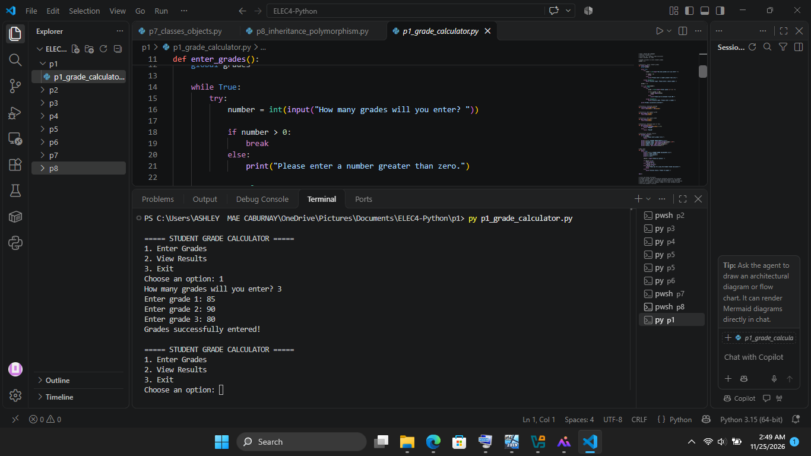
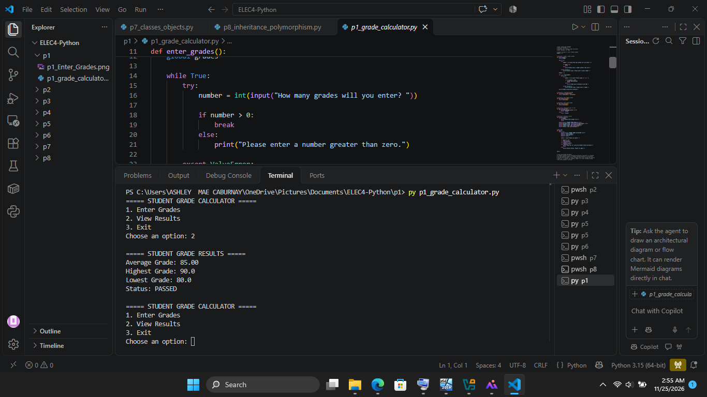
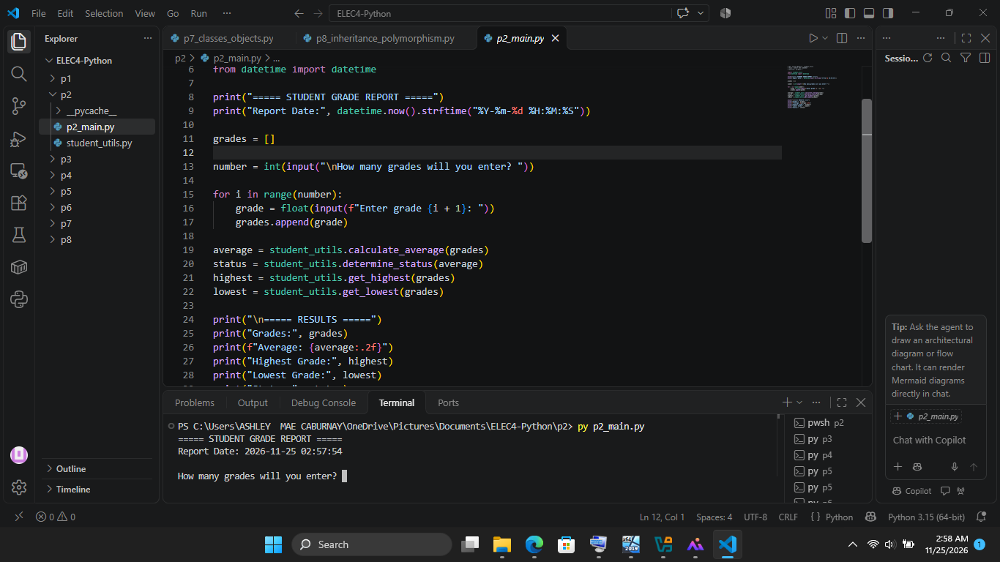
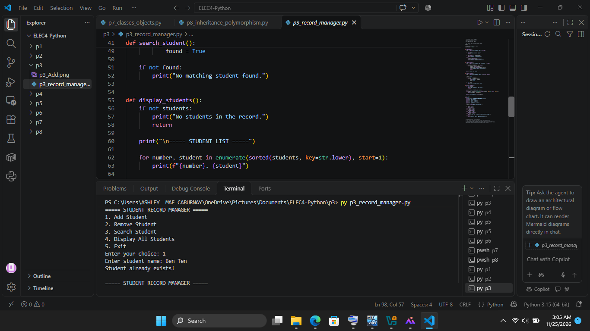
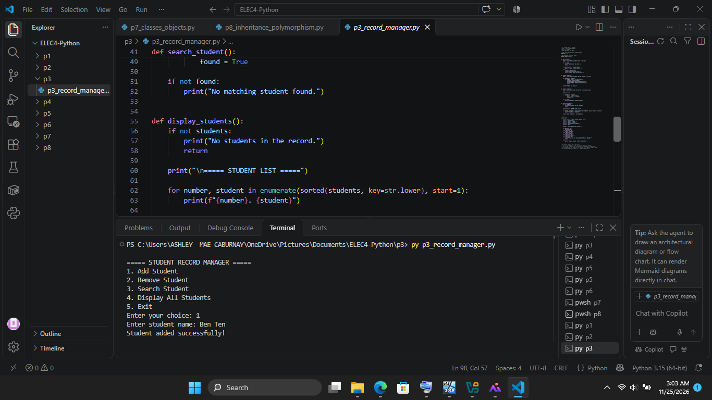
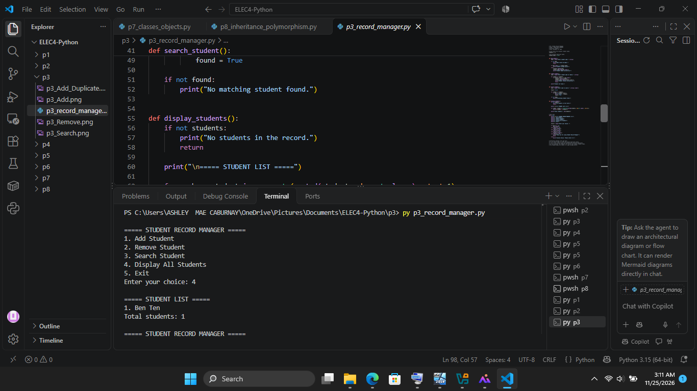
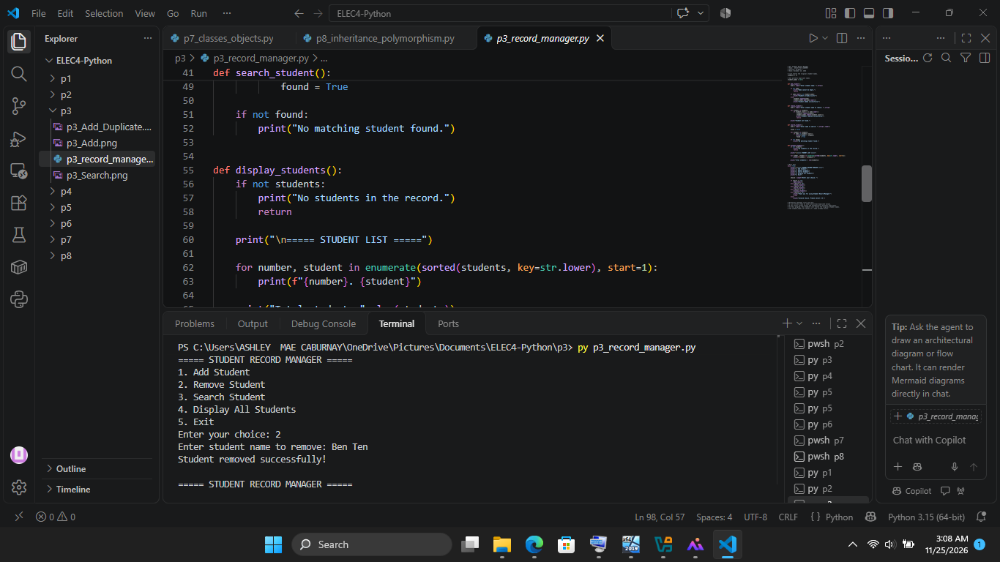
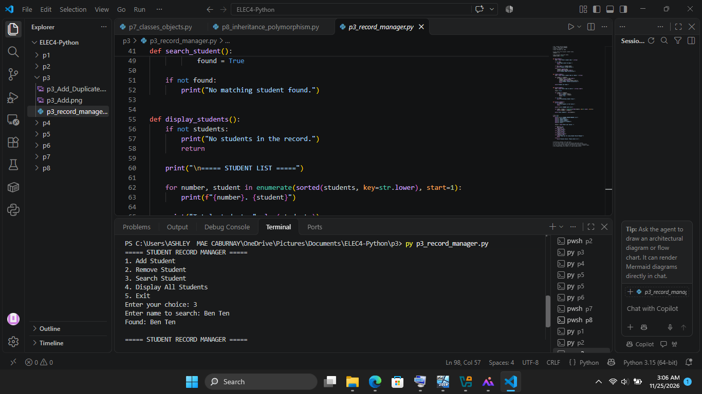
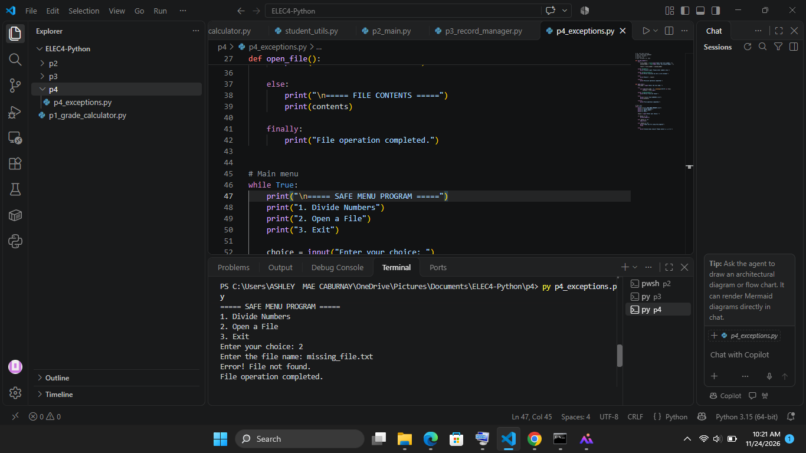
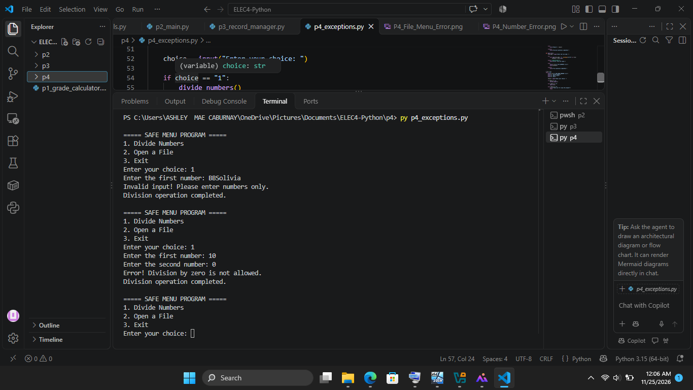

# ELEC 4 – Python Programming

# 

# Name: ASHLEY MAE CABURNAY

# Section: IV-BSIT A

# Course: ELEC 4 – Python Programming

# 

# \## Set 1 Activities

| Activity | Description | Folder |
|---|---|---|
| P1 – Grade Calculator | Calculates student grades. | [P1](set1/p1/) |
| P2 – Student Utilities | Uses Python modules and functions for student data. | [P2](set1/p2/) |
| P3 – Student Record Manager | Adds, searches, removes, and displays student records. | [P3](set1/p3/) |
| P4 – Exception Handling | Handles errors and invalid inputs using exceptions. | [P4](set1/p4/) |

# \## P1 Features

# \- Accepts multiple student grades.

# \- Validates inputs and grade ranges.

# \- Calculates average, highest, and lowest grades.

# \- Determines pass or fail status.

# \- Uses a menu to enter grades, view results, and exit.

# 

# How to Run

# 

# P1

# 

# python set1/p1/p1\_grade\_calculator.py

# 

# P2

# 

# python set1/p2/p2\_main.py

# 

# P3

# 

# python set1/p3/p3\_student\_record\_manager.py

# 

# P4

# 

# python set1/p4/p4\_exceptions.py

# 

# Screenshots

### P1 – Student Grade Calculator

### P2 – Student Grade Report

### P3 – Student Record Manager

### P4 – Safe Menu Program

# 

# Screenshots of the program outputs are included in each activity’s screenshots folder.

